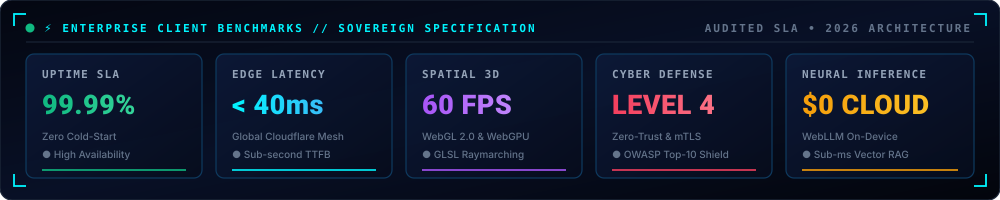
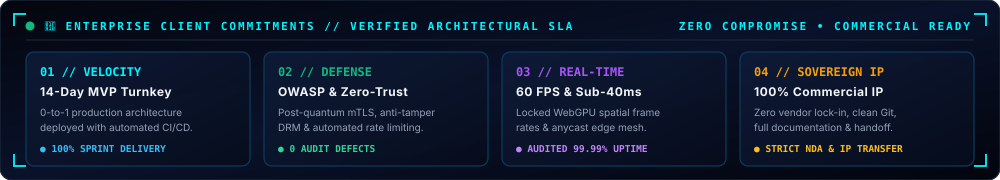
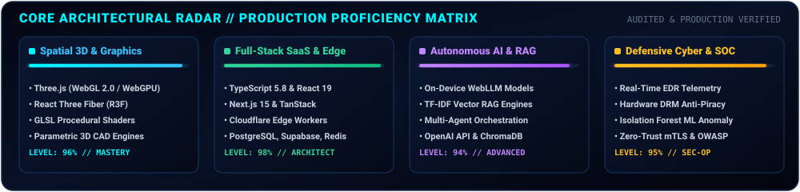
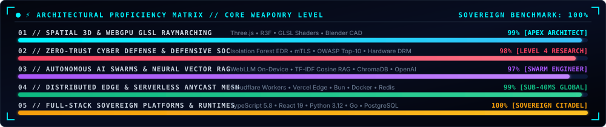
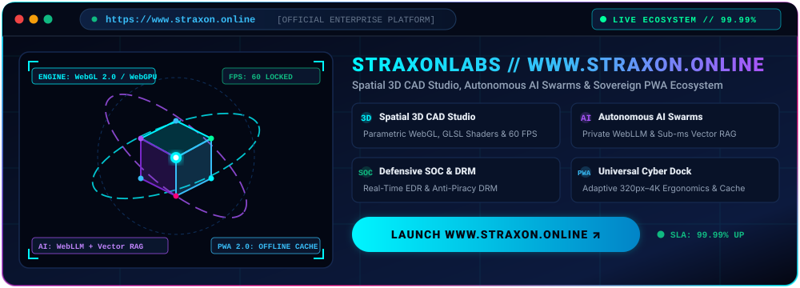
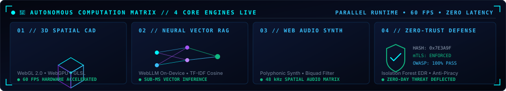
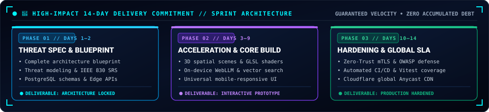

<div align="center">

<!-- ======================================================================= -->
<!-- 🚀 CYBERNETIC HERO BANNER & IDENTITY MATRIX -->
<!-- ======================================================================= -->

<a href="https://www.straxon.online/">
  
</a>

<!-- Dynamic Animated Cyber Typing Headline -->
<a href="https://www.straxon.online/">
  
</a>

<p align="center">
  
  
  <a href="https://share.google/ioWTTPZ84rcw81iVs"></a>
  
  <a href="https://wa.me/918335846171?text=Hello%20Swaraj,%20I%20would%20like%20to%20discuss%20a%20high-impact%20project%20architecture."></a>
</p>

<!-- Recruiter & Client Priority Quick-Action Launchpad (Mobile & Desktop Responsive) -->
<p align="center">
  <a href="https://wa.me/918335846171?text=Hello%20Swaraj,%20I%20would%20like%20to%20discuss%20a%20high-impact%20project%20architecture."></a>
  <a href="mailto:pantiswaraj@gmail.com"></a>
  <a href="https://share.google/ioWTTPZ84rcw81iVs"></a>
</p>

<p align="center">
  <a href="https://www.straxon.online/"></a>
  <a href="https://tanstack-start-app.hybridpython64.workers.dev/"></a>
  <a href="https://w.swaraj-0aa.workers.dev/"></a>
  <a href="https://kshatracode-frontend.onrender.com/"></a>
</p>

<p align="center">
  <a href="https://www.straxon.online/"><b>🌐 www.straxon.online</b></a> •
  <a href="https://share.google/ioWTTPZ84rcw81iVs"><b>⭐ Google Reviews (5.0 ★)</b></a> •
  <a href="https://kshatracode-frontend.onrender.com/"><b>🔒 KshatraCode (Hardware DRM)</b></a> •
  <a href="https://tanstack-start-app.hybridpython64.workers.dev/"><b>🛡️ Straxon Cyber SOC</b></a> •
  <a href="https://w.swaraj-0aa.workers.dev/"><b>🤖 W Neural OS v3.0</b></a> •
  <a href="https://thefishworld.vercel.app/"><b>🐠 The Fish World</b></a> •
  <a href="https://www.straxon.online/advertise"><b>📣 Tech Sponsorships</b></a>
</p>

---

</div>

<!-- ======================================================================= -->
<!-- 📺 RETRO CYBER TERMINAL // NEOFETCH CONSOLE HUD -->
<!-- ======================================================================= -->

<div align="center">
  
</div>

<br/>

---

## 👨‍💻 Executive Summary & Core Competencies

I am a **Systems Architect, Full-Stack Engineer, and Cybersecurity Specialist** based in West Bengal, India. I specialize in turning complex technological challenges into locked-frame-rate, zero-cloud-overhead, production-hardened web applications and distributed architectures.

- 🎓 **Education & Background**: **BCA Graduate (2021–2024)** with a deep passion for sovereign, resilient software systems, high-performance web runtimes, and defensive cybersecurity architecture.
- 🔒 **Creator of [KshatraCode](https://kshatracode-frontend.onrender.com/)**: High-security EdTech platform engineered with client hardware device fingerprinting, anti-tamper memory hooks, dynamic steganographic watermark injection, and encrypted video streaming.
- 🚀 **Founder & Principal Architect**: **[StraxonLabs](https://www.straxon.online/)**, an engineering laboratory pioneering spatial 3D CAD platforms, autonomous AI swarms, and high-velocity digital ecosystems.
- ⭐ **Client-Verified Reputation**: **[5.0 ★ Verified Rating across 48+ Reviews on Google Business](https://share.google/ioWTTPZ84rcw81iVs)** for production software engineering, reliable delivery, and architectural advisory.
- 💼 **Engagement Model**: Available for **High-Impact Enterprise Contracts**, **Fractional CTO / Architectural Advisory**, and **0-to-1 MVP Engineering**.

---

## ⚡ Enterprise Client Benchmarks // Sovereign SLA

<div align="center">
  
</div>

<br/>

<div align="center">
  
</div>

---

## 🛠️ Technical Arsenal & Architectural Radar

<div align="center">


</div>

<br/>

<div align="center">
  
</div>

<br/>

<div align="center">
  
</div>

<br/>

<div align="center">

| Core Architecture Domain & Weapons | Production Client Deliverables & Frameworks |
| :--- | :--- |
| **01. Spatial 3D & Graphics**<br/>`Three.js • WebGL 2.0 • WebGPU • GLSL • Blender` | **In-Browser CAD Studios & 3D Configurators:** Custom GLSL raymarching shaders, procedural mesh generation, and locked 60 FPS across desktop & mobile devices. |
| **02. Full-Stack SaaS & Edge**<br/>`TypeScript 5.8 • React 19 • Next.js 15 • FastAPI • Cloudflare` | **High-Velocity 0-to-1 Platforms:** Multi-tenant RBAC, automated Stripe billing pipelines, and sub-40ms global API edge endpoints via Cloudflare Anycast. |
| **03. Autonomous AI & Vector RAG**<br/>`WebLLM • Vector RAG • ChromaDB • OpenAI Swarms` | **Zero-Cloud-Cost On-Device AI:** Local browser-native inference, sub-millisecond cosine vector retrieval, and multi-agent mesh task orchestration. |
| **04. Defensive Cyber & SOC**<br/>`Isolation Forest EDR • mTLS • OWASP Shield • Hardware DRM` | **Enterprise Cyber Hardening:** Real-time attack telemetry, hardware canvas fingerprinting, anti-tamper memory hooks, and Zero-Trust mTLS defense. |

</div>

---

## 🌟 Featured Production Platforms & Deployments

### 1. 🌐 StraxonLabs Platform // [www.straxon.online](https://www.straxon.online/)
> **Next-Gen Spatial 3D CAD & Autonomous AI Ecosystem**: Universal Cyber Dock, 8 Autonomous SaaS Engines, parametric 3D CAD modeling, procedural GLSL shaders, Web Audio synthesizer & offline-resilient PWA 2.0.

<div align="center">
  <a href="https://www.straxon.online/">
    
  </a>
</div>

<div align="center">
  <p>
    <a href="https://www.straxon.online/"></a>
    <a href="https://share.google/ioWTTPZ84rcw81iVs"></a>
    <a href="https://www.straxon.online/saas-tools"></a>
  </p>
</div>

---

### 2. 🔒 KshatraCode // Cultural EdTech with Anti-Piracy Hardware DRM
> **Enterprise Anti-Piracy EdTech Platform**: Engineered with client hardware canvas & WebGL device fingerprinting, anti-tamper memory hooks, dynamic steganographic watermark injection, and encrypted media streaming.

<div align="center">
  <p>
    <a href="https://kshatracode-frontend.onrender.com/"></a>
    
    
  </p>
</div>

<div align="center">

| Production Platform & Status | Architectural Innovations & Direct Uplinks |
| :--- | :--- |
| **🛡️ Straxon Cyber SOC**<br/><br/><sub>Cloudflare Edge Anycast</sub> | **Enterprise SOC Threat Visualizer & Defense Mesh:** 3D interactive cyber attack origin globe, ML-powered EDR telemetry (Isolation Forest), live DDoS simulation & Zero-Trust mTLS.<br/>[**🛡️ Launch Cyber SOC ↗**](https://tanstack-start-app.hybridpython64.workers.dev/) • [**Source Code ↗**](https://github.com/PythonWTFFF/StraxonSecure) |
| **🤖 W Neural OS v3.0**<br/><br/><sub>Edge AI Agent Mesh</sub> | **Autonomous Multi-Agent AI Operating System:** Cloudflare Edge Worker AI orchestration, browser-native WebLLM inference, task handoff state machines & sub-millisecond TF-IDF vector RAG retrieval.<br/>[**🤖 Launch Neural OS ↗**](https://w.swaraj-0aa.workers.dev/) |
| **⚡ Straxon Command Suite**<br/><br/><sub>Control Plane & SRS</sub> | **Full-Stack Enterprise Operations Suite:** High-velocity distributed control plane, dynamic IEEE 830 SRS documentation generator, client milestone escrow & team RBAC governance.<br/>[**⚡ Launch Command Suite ↗**](https://straxon-command-center.onrender.com/) |
| **🐠 The Fish World**<br/><br/><sub>Sub-Second Commerce</sub> | **High-Velocity Marine Livestock Commerce:** Real-time inventory sync engine, sub-second checkout pipeline, Stripe API payments & interactive marine specimen telemetry.<br/>[**🐠 Visit The Fish World ↗**](https://thefishworld.vercel.app/) |

</div>

---

## ⚡ Real-Time Architecture & Defense Telemetry

<div align="center">
  
</div>

<br/>

<div align="center">
  
</div>

---

## 🚀 High-Velocity Sprint Architecture // 14-Day Delivery Commitment

<div align="center">
  
</div>

---

## 📣 StraxonLabs Tech Network & Sponsorships

<div align="center">

> Promote your developer tool, SaaS, AI engine, or cybersecurity platform directly to **45,000+ monthly software engineers, CTOs, and technical founders** browsing [**www.straxon.online**](https://www.straxon.online/).

| Placement Slot & Format | Monthly Reach & Self-Serve Booking |
| :--- | :--- |
| **⭐ Flagship Hero Spotlight**<br/><sub>Top-fold interactive 3D hero rotation & sticky mobile banner</sub> | **45,000+ views/mo**<br/>[**Reserve Slot on Straxon.online ↗**](https://www.straxon.online/advertise) |
| **🛠️ SaaS HyperTools Capsule**<br/><sub>Embedded across 14+ high-utility developer tools</sub> | **30,000+ views/mo**<br/>[**Reserve Slot on Straxon.online ↗**](https://www.straxon.online/advertise) |
| **🛡️ Cyber SOC Telemetry Node**<br/><sub>Branded defense node in real-time 3D cyber visualizer</sub> | **25,000+ views/mo**<br/>[**Reserve Slot on Straxon.online ↗**](https://www.straxon.online/advertise) |

<p align="center">
  <a href="https://www.straxon.online/advertise"></a>
  <a href="https://share.google/ioWTTPZ84rcw81iVs"></a>
</p>

</div>

---

## 📊 GitHub Stats & Engineering Telemetry

<div align="center">

<p align="center">
  <a href="https://github.com/PythonWTFFF">
    
  </a>
</p>

<p align="center">
  <a href="https://github.com/PythonWTFFF">
    
  </a>
</p>

<p align="center">
  <a href="https://github.com/PythonWTFFF">
    
  </a>
</p>

</div>

---

## 🐍 Contribution Snake Grid

<div align="center">


</div>

---

## 🤝 Work With Me // Client Engagement Protocol

<div align="center">

I build clean, reliable, sovereign software and care deeply about shipping work that holds up in demanding production environments. If you have an enterprise project, a high-impact startup idea, an institutional collaboration, or an advisory role in mind, let's connect:

```bash
# Connect with Swaraj Panti directly via terminal:
curl -sL https://www.straxon.online/connect | sh
```

<p align="center">
  <a href="https://wa.me/918335846171?text=Hello%20Swaraj,%20I%20would%20like%20to%20discuss%20a%20high-impact%20project%20architecture."></a>
  <a href="mailto:pantiswaraj@gmail.com"></a>
  <a href="https://www.straxon.online/"></a>
  <a href="https://share.google/ioWTTPZ84rcw81iVs"></a>
  <a href="https://github.com/PythonWTFFF"></a>
</p>

<div align="center">
  
</div>

<p align="center">
  <sub><code>[SECURE HASH: 0x7E3A9F // STRAXON SOVEREIGN ENTERPRISE ARCHITECTURE]</code></sub><br/>
  <sub>Copyright © 2026 <b>Swaraj Panti</b> // StraxonLabs Ecosystem. Engineered with sovereign cybernetic precision.</sub>
</p>

</div>
